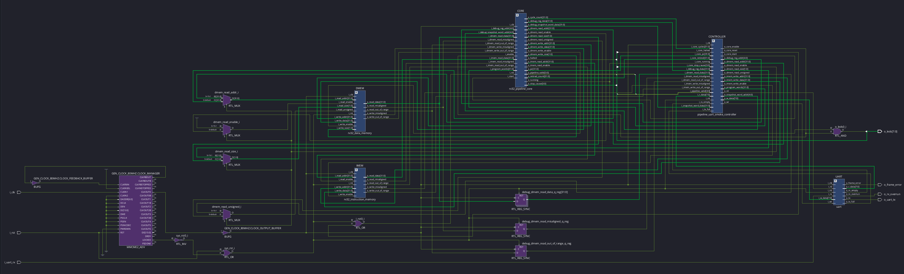
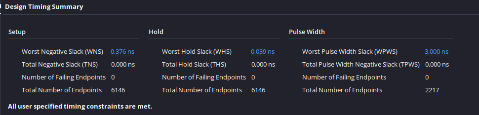
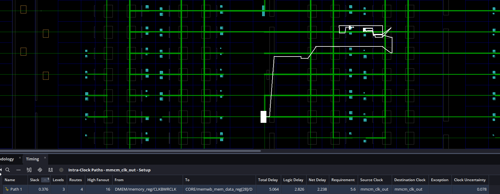
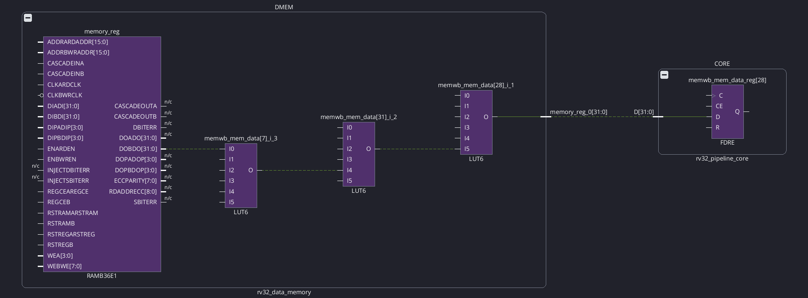

# Informe de trabajo práctico final de arquitectura de computadoras 2026
### Profesor: Alonso Pereyra Martín
###  Estudiantes: Potinski Mijail Andrés, Cisneros Tomás Alejo.

 

## 1. Objetivos y consignas

El objetivo del presente trabajo práctico final es diseñar e implementar un procesador de arquitectura RISC-V de 32 bits sobre la FPGA de la placa Basys 3, utilizando un pipeline de cinco etapas y sin memoria caché. Para ello se busca integrar los conceptos de camino de datos, generación de señales de control y segmentación de instrucciones, junto con los módulos de procesamiento y comunicación desarrollados en los trabajos prácticos anteriores.

La organización del procesador comprende las etapas de búsqueda de instrucción (IF), decodificación y lectura de registros (ID), ejecución (EX), acceso a memoria (MEM) y escritura de resultados (WB). Esta estructura permite superponer el procesamiento de distintas instrucciones, de manera que cada etapa trabaje sobre una instrucción diferente durante un mismo ciclo de reloj. El diseño debe contemplar los riesgos estructurales, de datos y de control que aparecen como consecuencia de esta superposición, incorporando los mecanismos necesarios para conservar el orden y la corrección de los resultados.

Como alcance del trabajo, se requiere implementar el subconjunto de 32 instrucciones RV32I definido por la consigna, que incluye operaciones aritméticas y lógicas, desplazamientos, comparaciones, cargas y almacenamientos de distintos tamaños, saltos condicionales e incondicionales y carga de inmediato superior. El procesador debe disponer de un banco de 32 registros y memorias separadas para instrucciones y datos. Las escrituras deben realizarse en el flanco positivo del reloj y las lecturas en el flanco negativo. También se debe contemplar una instrucción de finalización del programa, representada mediante `halt` y codificada como `ebreak`, de modo que las instrucciones anteriores completen su ejecución y el pipeline quede vacío antes de informar la detención.

Otro objetivo es incorporar una unidad de depuración (Debug Unit) que permita controlar y observar el procesador desde una computadora mediante la comunicación UART reutilizada del TP2. Esta unidad debe permitir cargar y reemplazar programas en la memoria de instrucciones sin volver a sintetizar el diseño, iniciar la ejecución continua, pausar, reanudar, reiniciar y avanzar paso a paso. En este último modo, cada orden debe producir exactamente un ciclo de avance del procesador. Además, se debe poder consultar el banco de registros, la memoria de datos y el contenido de los registros intermedios del pipeline, junto con el contador de programa, los contadores de ejecución y la causa de parada.

El trabajo contempla también el desarrollo de software en Python para traducir programas escritos en ensamblador a código máquina, transmitirlos a la FPGA y presentar el estado del sistema mediante una interfaz gráfica. De esta manera, se busca relacionar las instrucciones del programa con su recorrido por las distintas etapas y observar los efectos de las dependencias, las pausas y los cambios de flujo durante la ejecución.

Finalmente, se debe verificar el funcionamiento de los módulos mediante simulaciones y pruebas de integración, y comprobar el sistema completo sobre la placa. La evaluación incluye el análisis de utilización de recursos y del comportamiento temporal posterior a la implementación en Vivado, identificando el camino crítico y una frecuencia de operación que cumpla las restricciones de timing. También se busca comprobar la carga sucesiva de distintos programas, el funcionamiento de los modos continuo y paso a paso, y la finalización con el pipeline vacío.

## 2. Funcionamiento del sistema

El sistema permite cargar un programa desde una computadora, ejecutarlo en el procesador implementado sobre la Basys 3 y observar su estado interno. Para ello se organiza en tres bloques principales: el procesador RISC-V, la unidad de depuración o Debug Unit y el software de la computadora. La comunicación entre la computadora y la FPGA se realiza mediante UART, reutilizando el subsistema desarrollado en el TP2.

El procesador se encarga de ejecutar las instrucciones almacenadas en memoria. La Debug Unit administra la carga del programa, el control de ejecución y las consultas de estado. Por su parte, el software permite enviar estos comandos y presentar los resultados mediante una interfaz gráfica.

El intercambio general puede representarse como:

`Computadora ↔ UART ↔ Debug Unit ↔ Procesador y memorias`

### 2.1. Organización del procesador

El procesador trabaja con datos e instrucciones de 32 bits y utiliza un pipeline de cinco etapas. En lugar de completar una instrucción antes de comenzar la siguiente, divide su procesamiento en tareas sucesivas que pueden realizarse simultáneamente sobre instrucciones diferentes.

Por ejemplo, mientras una instrucción realiza una operación en la ALU, otra puede estar leyendo sus operandos y una tercera puede estar siendo buscada en memoria. Esta superposición permite aumentar la cantidad de instrucciones procesadas por unidad de tiempo, aunque una instrucción individual siga necesitando recorrer varias etapas.

El recorrido principal es:

`IF → IF/ID → ID → ID/EX → EX → EX/MEM → MEM → MEM/WB → WB`

Los bloques IF/ID, ID/EX, EX/MEM y MEM/WB son registros intermedios que conservan los datos y las señales de control necesarios para la etapa siguiente. Cada uno incorpora un bit `valid`, que indica si su contenido corresponde a una instrucción válida. Cuando este bit vale cero, la etapa contiene una burbuja y no debe producir escrituras en registros ni en memoria.

### 2.2. Etapas del pipeline

**Búsqueda de instrucción (IF)**

El contador de programa, denominado PC, indica la dirección de la instrucción que se debe buscar en la memoria de instrucciones. Como cada instrucción ocupa cuatro bytes, durante la ejecución secuencial el PC avanza de cuatro en cuatro. La instrucción obtenida y su dirección se almacenan en IF/ID. Cuando se resuelve un salto, el PC toma la dirección de destino en lugar de continuar con la secuencia habitual.

**Decodificación y lectura de registros (ID)**

El decoder interpreta la instrucción e identifica la operación, los registros fuente y el registro destino. A partir de esta información genera las señales de control que determinan el comportamiento de las etapas posteriores, como la operación de la ALU, el acceso a memoria y la selección del resultado que se escribirá al finalizar.

En esta etapa también se leen los operandos del banco de registros y se construye el inmediato correspondiente al formato de la instrucción. El banco contiene 32 registros de 32 bits; el registro `x0` siempre devuelve cero y no puede modificarse. Los operandos, el inmediato y los controles se almacenan en ID/EX.

**Ejecución (EX)**

La ALU realiza las operaciones aritméticas y lógicas, los desplazamientos y las comparaciones requeridas. En las instrucciones de carga y almacenamiento calcula la dirección efectiva sumando el registro base y el desplazamiento inmediato.

Los saltos también se resuelven en esta etapa. Para `beq` y `bne` se comparan los operandos; para `jal` y `jalr` se determina el destino y se conserva `PC+4` como dirección de retorno. Los resultados necesarios para continuar se almacenan en EX/MEM.

**Acceso a memoria (MEM)**

Las instrucciones de carga leen la memoria de datos y las de almacenamiento escriben en ella. El acceso puede ser de un byte, media palabra de 16 bits o una palabra de 32 bits. En las cargas de menor tamaño, el dato se extiende a 32 bits con signo o con ceros según la instrucción.

Las instrucciones que no acceden a memoria atraviesan esta etapa conservando su resultado. La información que debe llegar a la escritura final se almacena en MEM/WB.

**Escritura de resultados (WB)**

Se selecciona el valor que corresponde escribir en el registro destino: el resultado de la ALU, un dato leído de memoria o la dirección de retorno `PC+4`. La escritura se realiza únicamente si la instrucción es válida y tiene habilitada esa operación. Instrucciones como los almacenamientos y los saltos condicionales no escriben en el banco de registros.

### 2.3. Memorias y temporización

El sistema utiliza una organización Harvard, con una memoria de instrucciones (IMEM) y una memoria de datos (DMEM) independientes, de 4 KiB cada una. Esta separación permite buscar una instrucción y acceder a un dato durante el mismo ciclo sin disputar un único puerto de memoria. Ambas memorias se implementan mediante bloques BRAM de la FPGA y se accede a ellas directamente, sin caché.

La memoria de datos utiliza el orden little-endian: el byte menos significativo de una palabra ocupa la dirección más baja. Los accesos de media palabra deben estar alineados a dos bytes y los de palabra a cuatro bytes. Un acceso desalineado o fuera del rango permitido genera una condición de error.

Los registros del pipeline y las escrituras se actualizan en el flanco positivo del reloj, mientras que las lecturas de las memorias y del banco de registros se realizan en el flanco negativo. La frecuencia interna adoptada es de 90 MHz, generada mediante un MMCM a partir del reloj de 100 MHz de la placa. Las pausas se implementan mediante señales de habilitación, manteniendo el reloj físico en funcionamiento.

### 2.4. Resolución de riesgos

La superposición de instrucciones introduce dependencias que deben resolverse antes de utilizar los operandos. Si una instrucción necesita un resultado que una anterior todavía no escribió en el banco de registros, el mecanismo de forwarding puede tomarlo desde EX/MEM o MEM/WB y enviarlo directamente a la etapa EX. Cuando ambos contienen un resultado para el mismo registro, se prioriza el de EX/MEM por corresponder a la instrucción productora más reciente. También existe un bypass de WB hacia ID para resolver lecturas que coinciden con la escritura del mismo registro.

En una dependencia inmediata de una carga, denominada load-use, el dato todavía no está disponible para reenviarlo desde EX/MEM. En este caso se conserva el PC y el contenido de IF/ID durante un ciclo, y se introduce una burbuja en ID/EX. Las instrucciones anteriores continúan avanzando hasta que el dato puede utilizarse.

Los riesgos de control aparecen cuando un salto modifica el recorrido del programa. Como la decisión se conoce en EX, pueden haberse buscado y decodificado instrucciones del camino que no corresponde ejecutar. Cuando se toma el salto, estas instrucciones se anulan mediante los bits `valid` y la búsqueda continúa desde la nueva dirección.

### 2.5. Comunicación y control de ejecución

La UART transmite los comandos y las respuestas a 115200 baudios, con ocho bits de datos, sin paridad y un bit de parada. Puede utilizarse el conversor USB-UART integrado de la placa o el CP2102 externo conectado al Pmod JA. El adaptador convierte la comunicación USB de la computadora en las señales serie TX y RX utilizadas por la FPGA.

La Debug Unit interpreta los comandos recibidos y coordina las operaciones sobre el procesador. Permite iniciar la ejecución continua, pausarla conservando el contenido del pipeline, reanudarla, reiniciar el core y avanzar paso a paso. Un comando `Step` habilita exactamente un ciclo de avance: no equivale a completar una instrucción, ya que varias instrucciones pueden desplazarse simultáneamente por sus respectivas etapas.

La pausa y la finalización tienen comportamientos diferentes. Durante una pausa, las instrucciones permanecen en las etapas en las que se encontraban. Cuando se reconoce `ebreak`, utilizado como `halt`, se detiene el ingreso de nuevas instrucciones y se permite que las anteriores terminen. El procesador informa la finalización cuando los cuatro registros intermedios quedan sin instrucciones válidas. Las instrucciones ilegales y los errores de acceso también generan una parada cuya causa puede consultarse desde la computadora.

### 2.6. Carga y observación de un programa

La interfaz gráfica utiliza un cliente Python para enviar los comandos y recibir las respuestas de la FPGA. Actualmente permite cargar imágenes de código máquina en formato `.hex` o `.bin`; la traducción desde un archivo ensamblador forma parte del desarrollo previsto del software.

Al cargar un programa desde la GUI, el cliente reinicia el core, escribe las instrucciones en IMEM y prepara la ejecución desde PC cero en estado pausado. De esta manera, el usuario puede comenzar con pasos individuales o habilitar la ejecución continua. La cantidad de palabras cargadas define el límite ejecutable de la imagen, por lo que alcanzar una dirección fuera de ese límite produce una parada por error.

Para observar el pipeline se utiliza un snapshot, que contiene el estado global y los datos de IF/ID, ID/EX, EX/MEM y MEM/WB. Esta captura se consulta con el procesador pausado, detenido o inactivo, evitando que su contenido cambie mientras se transmite por UART. Los registros del banco y la memoria de datos se consultan mediante operaciones adicionales. La GUI presenta los valores recibidos y desensambla las instrucciones para facilitar su lectura.

El recorrido de uso del sistema puede resumirse como:

`Cargar imagen → iniciar pausado → ejecutar o avanzar un ciclo → consultar el estado → continuar hasta la finalización`

Este mecanismo permite relacionar cada instrucción con los operandos, resultados y señales de control que transporta, y observar cómo los riesgos y los saltos modifican el avance del pipeline.

## 3. Implementación sobre Basys 3

La memoria esta separada en dos bloques, datos e instrucciones, las cuales fueron creadas con BRAM mediante codigo verilog. Son dos arreglos de 1024 palabras, dando en total 4 KiB, ya que 1024 x 4 bytes = 4096 bytes.

El clock se genera mediante el modulo MMCM que duplica los 100 MHz a 900 y luego los dividimos por 10 para obtener 90 MHz

### N. Esquematico

### N. Análisis temporal
El analisis temporal realizado por vivado nos mostró que a una frecuencia de 100 Mhz, no cerrabamos el timing, el WNS estaba en negativo con -0.184 nanosegundos.

Bajamos la frecueciencia mediante el clock generator a 90 Mhz y cerramos timings, con un pequeño margen pero funcional.
Con un WNS de 0.376 ns, WHS de 0.039 ns, sin fallar ningun endpoint.

Camino mas largo es desde memoria de datos hacia un registro del core, con 5.064 ns usados de los 5.556 ns como maximo que tiene la mitad del clock ya que es una lectura. 

se prodria mejorar este camino, agregando un registo intermedio es la forma mas facil, mejorando el enrutado o el lugar del registro.
